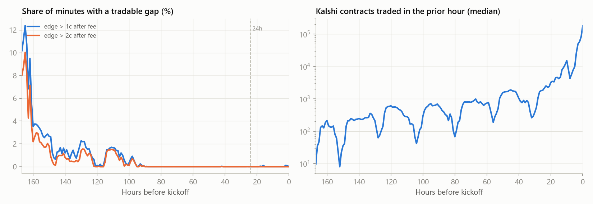
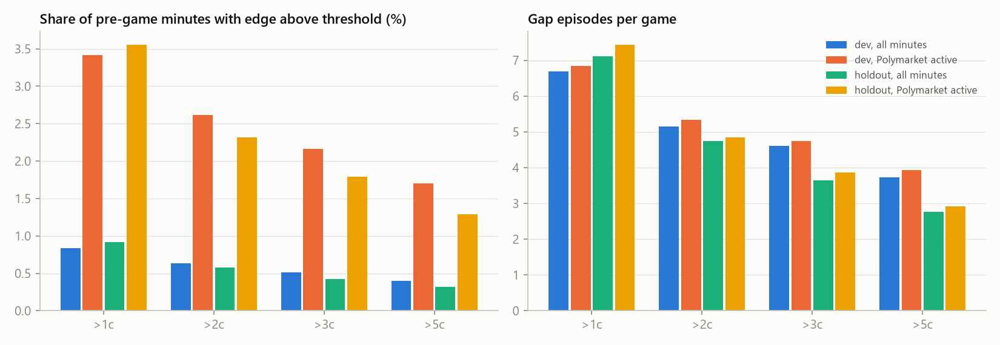
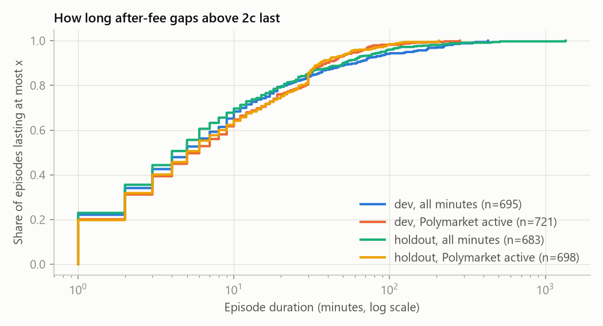
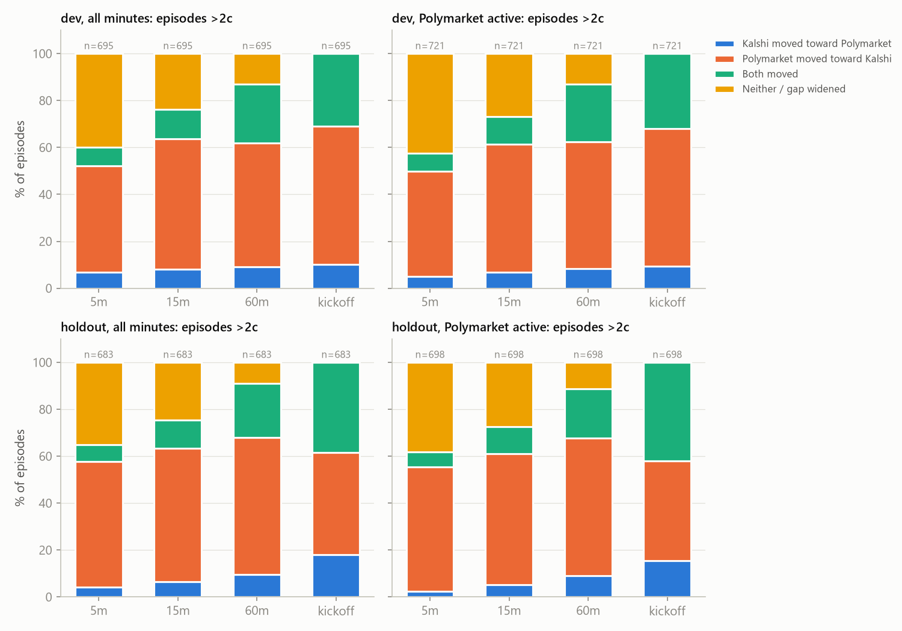
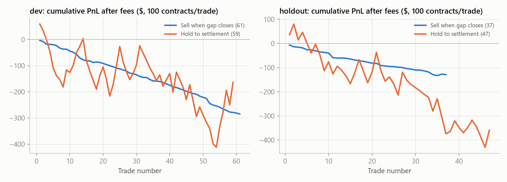
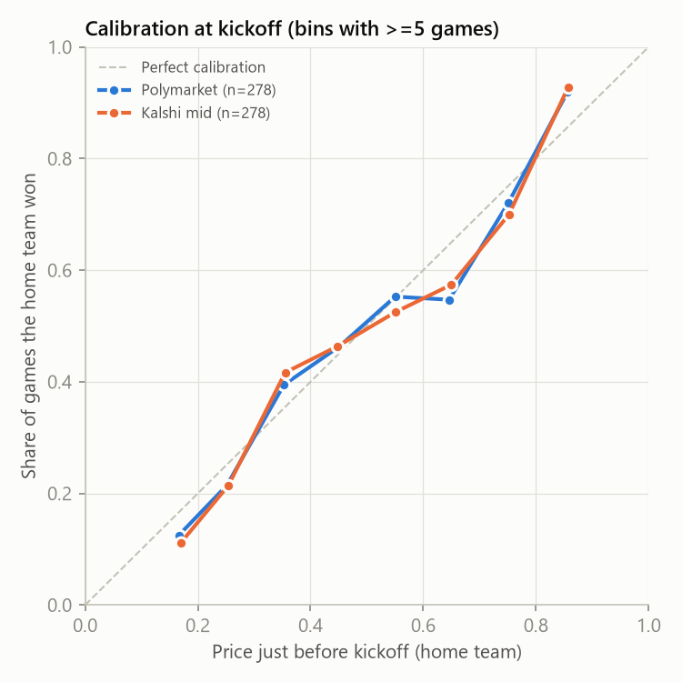

# Kalshi vs Polymarket: NFL game-winner price gaps, 2025 season

*Phase 1 historical study, built only from public read-only data: Kalshi market data, Polymarket's Gamma and
CLOB APIs, and nflverse. The appendices are regenerated from the database by `kpm report`. This summary was
written after reading those results.*

## Bottom line

**Don't build the live system as designed.** In the 2025 season, Kalshi's NFL game-winner prices did not drift
away from Polymarket's by more than Kalshi's fee at any time when Kalshi had real trading volume.

1. **No tradable gaps on game day.** In the final 24 hours before kickoff there was **not one after-fee gap
   above 2¢** across 279 games, and the largest after-fee edge in that window was **1.8¢**. Those 24 hours
   hold **82% of Kalshi's volume** for the final pre-game week (51% in the last 3 hours alone).
2. **The gaps that existed came early in the week, with thin books.** 99% of gaps above 2¢ began **more than
   4 days before kickoff**, and 77% within the first day after Polymarket listed the game. The biggest ones
   came from Polymarket's price sitting near 50¢ while its new order book was still empty.
3. **When a gap opened, Polymarket moved to Kalshi.** Within 15 minutes Polymarket had moved toward Kalshi in
   56–57% of gaps, and Kalshi had moved toward Polymarket in 7–8%. That is the opposite of the premise.
4. **Every strategy lost money after fees.** All 32 parameter sets lost money on the early weeks (best:
   −2.0¢ per contract). The sets chosen there lost again on the later weeks: **−3.5¢** per contract for "sell
   when the gap closes" and **−7.6¢** for "hold to settlement".
5. **Polymarket is a good fair price near kickoff, but no better than Kalshi.** At kickoff, Polymarket, Kalshi
   and the sportsbook closing line were equally well calibrated. Kalshi was slightly better than Polymarket
   at every horizon tested.

## What the data shows

### 1. How often did a gap beat Kalshi's fee?

On a 1-minute grid, *edge* means how much cheaper Kalshi's YES (or NO) ask was than the Polymarket price,
after Kalshi's taker fee on a 100-contract order.

| Final 7 days before kickoff | Early weeks (1–9): 135 games | Later weeks + playoffs: 144 games |
|---|---|---|
| Share of minutes with edge > 1¢ | 0.83% | 0.92% |
| Share of minutes with edge > 2¢ | 0.64% | 0.58% |
| Share of minutes with edge > 5¢ | 0.40% | 0.32% |
| Gap episodes > 2¢ (games with at least one) | 695 (68 games) | 683 (82 games) |
| Median episode length | 5 min | 4 min |
| Episodes > 2¢ starting in the final 24 h | **0** | **0** |
| Episodes > 1¢ starting in the final 24 h | 5 (in at most 3 games) | 8 (in at most 4 games) |

**When:** gaps bunch up on the Sunday afternoon a week before the game, which is Polymarket's first day of
trading for that game. 80% of gaps for Sunday games started between 1pm and midnight ET that Sunday, while the
previous week's games were being played. Even for Thursday games, most gaps started on the Sunday before.
From about 4 days before kickoff onward, the two prices sit about half a cent apart on average and after-fee
gaps all but disappear. Gaps above 2¢ appear in 0.004% of minutes between 1 and 4 days out, and never in the
final day.

**Liquidity:** when a gap opened, the Kalshi market had typically traded about 100 contracts in the previous
hour. In the final three hours before kickoff the median was 50,000–180,000 contracts an hour.

**Why the biggest gaps aren't real opportunities:** 154 gaps opened at 20¢ or more.
- **Empty-book midpoints:** 61% started with Polymarket's published price at 45–55¢ while Kalshi traded well
  away from 50¢ (outside 35–65¢), and 99% started within a day of Polymarket listing the game. Polymarket's
  history publishes a midpoint-style price, and the midpoint of an empty book is about 50¢. Example: LA–CAR
  (Nov 24), where Polymarket sat near 0.50 for about 22 hours while Kalshi traded the Rams at 0.84–0.87.
- **One-minute spikes:** others were single-minute jumps that snapped straight back. Example: CLE–BAL
  (Sep 7), Polymarket 0.175 → 0.56 → 0.175 with Kalshi unchanged.

### 2. After a gap opened, who moved?

Gaps above 2¢, all minutes:

| | Kalshi moved toward Polymarket | Polymarket moved toward Kalshi | Both | Neither |
|---|---|---|---|---|
| Early weeks, after 5 / 15 / 60 min | 7% / 8% / 9% | 45% / 56% / 53% | 8% / 13% / 25% | 40% / 24% / 13% |
| Later weeks, after 5 / 15 / 60 min | 4% / 7% / 10% | 53% / 57% / 59% | 7% / 12% / 23% | 35% / 25% / 9% |

- **Size of the moves:** within an hour, Kalshi's mid moved 0.2–1.2¢ toward Polymarket on average, while
  Polymarket moved 2.7–8.7¢ toward Kalshi. Every gap had closed by kickoff, mostly through Polymarket's
  price.
- **Robustness:** the pattern holds by time before kickoff, Kalshi spread, Kalshi volume and favorite vs
  underdog (Appendix C). Kalshi is the anchor and Polymarket the follower.
- **One nuance:** for the roughly 300 gaps that opened at least a day after Polymarket listed the game, Kalshi
  did more of the moving over the following hours or days. In the later weeks (about 210 such gaps), by
  kickoff Kalshi had moved
  toward Polymarket in 30% of them and Polymarket toward Kalshi in 42%. Average moves were 5.2¢ for Kalshi and
  3.8¢ for Polymarket. In the first 15 minutes Polymarket still did most of the moving (47% vs 12%).
  Section 3 shows these gaps weren't tradable either.

### 3. Could you have made money on Kalshi?

How the simulation works:
- **Entry:** buy at the Kalshi ask, paying the taker fee.
- **Fill check:** a trade counts only if Kalshi's own prints showed at least 100 contracts traded at that
  price or better within ±1 minute.
- **Parameters:** chosen on the early weeks only (from 32 combinations), then applied unchanged to the later
  weeks.

| Strategy (parameters chosen on early weeks) | Early weeks | Later weeks |
|---|---|---|
| **Sell when the gap closes** (edge > 1¢, Polymarket active, Kalshi ≥ 1,000 contracts in prior hour) | 61 trades in 32 games: **−4.7¢**/contract (95% CI −5.4 to −3.9), 2% winners | 37 trades in 24 games: **−3.5¢** (CI −4.6 to −2.2), 5% winners |
| **Hold to settlement** (edge > 2¢, all minutes) | 59 trades in 39 games: **−2.8¢** (CI −15.5 to +10.2), 41% winners | 47 trades in 35 games: **−7.6¢** (CI −20.0 to +7.3), 38% winners; worst drawdown $511 at 100 contracts |

- **Sell when the gap closes:** the gap usually closed because Polymarket moved, so the trade just paid
  Kalshi's spread plus two fees.
- **Hold to settlement:** amounts to a bet on the game minus the fee. The wide confidence intervals are
  game-outcome noise, not an edge.
- **Not fillable anyway:** 72% (early) and 83% (later) of 2¢ gap openings had too little Kalshi volume
  nearby to fill 100 contracts.
- **No sub-group worked:** splitting by time before kickoff, Kalshi spread, Kalshi volume or favorite vs
  underdog gives nothing positive in both halves. The one exception has 3 trades in total.
- **Post-hoc check** (defined after seeing the data, so outside the clean protocol): using only gaps that
  opened at least a day after Polymarket listed the game changes nothing.
  - Sell when closed: −4.2¢ and −3.3¢.
  - Hold: +4.9¢ on 13 trades, then −10.4¢ on 23 trades.

### 4. Is Polymarket a trustworthy fair price?

Brier score for the home-team probability vs the result (lower is better). 278 games, with the one tie
excluded.

| Time before kickoff | Polymarket | Kalshi mid | Sportsbook closing line |
|---|---|---|---|
| 24 hours | 0.2137 | 0.2131 | – |
| 3 hours | 0.2140 | 0.2136 | – |
| Kickoff | 0.2127 | 0.2124 | 0.2124 |

Near kickoff all three are well calibrated and practically identical, which is why gaps disappear then. Early
in the week, when gaps do exist, Polymarket's price is the less reliable of the two.

## Data limitations

- **Polymarket time resolution was 1 minute for all 570 outcome tokens.** It was never coarser, so the Data
  API trades fallback wasn't needed. But this series has limits:
  - It is **one midpoint-style price per minute, with no bid, ask, depth or volume**, so we can't tell whether
    the price was tradable. The two outcomes' prices are exact complements.
  - It prints a point every minute even when nothing changed. The appendices therefore also show a
    "Polymarket active" view (price changed within 30 minutes). Both views lead to the same conclusions.
  - Gap speed below 1 minute can't be measured. The 5-minute results rest on five 1-minute steps, and very
    brief dislocations on either venue would be invisible.
- **Kalshi data:** 1-minute candles (bid/ask at the close of each minute, trade prices, volume) plus every
  trade (5.2M). Quotes are carried forward through quiet minutes. 561 of 564 markets have a median spacing of
  60 seconds.
- **Window: the final 7 days before kickoff.** Polymarket listed 86% of games earlier than that (median 7.6
  days ahead; a quarter 13–14 days ahead), so the earliest part of each game's overlap is not included. Those
  are the thinnest, most gap-prone hours on both venues. Including them would raise the raw gap counts but
  shouldn't change the trading conclusion. Extending to 14 days is a config change plus about an hour of
  free data collection.
- **Fill realism:** uses Kalshi prints at our price or better within ±1 minute. It doesn't model queue
  position or our own market impact.
- **Kickoff time:** pre-game data is cut at nflverse's scheduled kickoff. Polymarket's own start time was
  5 hours off in 3 games and 15 minutes off in 1.

## Caveats

- **One season, 279 games.** Strategy results rest on 37–82 trades each and are flagged where below 30 games or
  50 trades. The conclusion doesn't hinge on any one number, though:
  - gaps were rare and confined to thin early-week books;
  - they closed mainly through Polymarket;
  - every parameter set lost money.
- **Excluded games:** six playoff and late-season games are left out.
  - Both conference championships and the Super Bowl had no usable Kalshi `KXNFLGAME` market.
  - Flexed week-18 CAR–TB and SEA–SF and the divisional SF–SEA game await your approval in
    `review/manual_review.csv`. The AI review found them the same event; they were flagged only because
    Kalshi's ticker date differs from the game date.
- **Settlement rules differ in rare cases:**
  - Kalshi pays a "fair price" on cancellation, where Polymarket resolves 50-50.
  - Postponement windows differ.
  - Polymarket's text is silent on ties for 354 pairs, yet its one 2025 tie (GB–DAL) settled 50/50, like
    Kalshi.
  - None of these affected a 2025 pre-game price.
- **Fees:** modelled as 0.07 × P × (1−P) per contract, rounded up to the cent per 100-contract order. Kalshi's
  docs now describe sub-cent fee accounting; exact rounding moves results by at most a few tenths of a cent.
- **Markets change.** Kalshi's per-game pre-game volume varied 2–4x across regular-season weeks and was far
  higher in the playoffs, and 2026 liquidity could differ again. Nothing here points to an edge that would appear with more volume.
  Volume is exactly what made the gaps disappear.

## Recommendation

**Not worth building the live Polymarket-reference trading system for Kalshi NFL game winners.** The edge
it targets didn't exist in the hours when Kalshi has liquidity. Where gaps did appear, Kalshi was the better
price, and trading Kalshi toward Polymarket lost money after fees in every variant tested.

The collectors, database schema and matcher agent work and are reusable. If you want to keep exploring, two
questions this codebase could test cheaply with public data are:

1. Whether Kalshi lags sportsbook closing lines on game day.
2. Whether Kalshi is the follower in thinner markets (spreads, totals, other leagues).

Neither is built.


## Appendix A. Data and coverage

- Season: **2025** (285 regular-season and playoff games in nflverse).
- Games with no usable Kalshi `KXNFLGAME` market (excluded): 2025_21_LA_SEA, 2025_21_NE_DEN, 2025_22_SEA_NE.
- Matched pairs by status: approved: 874, manual_review: 12. Only `approved` pairs are analyzed.
- Games in analysis: early weeks (dev, weeks 1–9) **135**,
  later weeks + playoffs (holdout) **144**.
- Window: the 7 days before scheduled kickoff, strictly pre-game.
- Simulated order size: 100 contracts. Fee model: `0.07 × C × P × (1−P)`, rounding `cent_ceil`, taker only.

### Actual time resolution per market

| Venue | Markets | Median spacing (s) | 90th pct spacing (s) | Max spacing (s) |
|---|---|---|---|---|
| Kalshi (1-min candles) | 564 | 60 | 60 | 120 |
| Polymarket (CLOB prices-history) | 570 | 60 | 60 | 60 |

Polymarket series source counts: {'poly_prices_history': 570}. The per-market list is in `results/price_resolution_by_market.csv`.
Polymarket's two outcome series sum to 1. Mean absolute deviation is 0.0000c,
95th pct 0.0000c. They are exact complements, so `prices-history` publishes one
series per market (a midpoint-style price). It carries **no bid/ask and no volume**, and it prints every minute even
when nothing changes.


## Appendix B. How often after-fee gaps exceeded 1, 2, 3 and 5 cents

An **episode** is a run of consecutive minutes where buying YES (or NO) at the Kalshi ask beats the
Polymarket price by more than the threshold **after** Kalshi's fee. **All minutes** uses every minute with
fresh data on both venues. **Polymarket active** keeps only minutes where the Polymarket price changed in
the previous 30 minutes. `prices-history` prints a point every minute even when nothing trades,
so the first view includes minutes where Polymarket's book was dormant.





The "Polymarket active" bars are taller on the left because their denominator is smaller: only active minutes
count. The number of episodes (right) barely changes, so most gaps happen while Polymarket's price is moving.

| Data | Split | Threshold (c) | Games | % minutes above | Episodes | Games with ≥1 | Episodes/game | Median duration (min) | P90 duration (min) | % lasting ≥5 min |
|---|---|---|---|---|---|---|---|---|---|---|
| active | dev | 1 | 135 | 3.42 | 923 | 73 | 6.84 | 5.00 | 39.80 | 52.76 |
| active | dev | 2 | 135 | 2.62 | 721 | 61 | 5.34 | 6.00 | 39.00 | 55.06 |
| active | dev | 3 | 135 | 2.16 | 640 | 56 | 4.74 | 5.00 | 35.10 | 53.91 |
| active | dev | 5 | 135 | 1.70 | 531 | 50 | 3.93 | 5.00 | 33.00 | 54.43 |
| active | holdout | 1 | 144 | 3.56 | 1,071 | 97 | 7.44 | 5.00 | 35.00 | 52.85 |
| active | holdout | 2 | 144 | 2.31 | 698 | 74 | 4.85 | 5.00 | 36.00 | 54.30 |
| active | holdout | 3 | 144 | 1.79 | 557 | 62 | 3.87 | 4.00 | 38.00 | 48.29 |
| active | holdout | 5 | 144 | 1.29 | 420 | 45 | 2.92 | 3.00 | 36.10 | 43.33 |
| all | dev | 1 | 135 | 0.83 | 903 | 81 | 6.69 | 4.00 | 63.80 | 49.17 |
| all | dev | 2 | 135 | 0.64 | 695 | 68 | 5.15 | 5.00 | 61.00 | 52.09 |
| all | dev | 3 | 135 | 0.51 | 623 | 62 | 4.61 | 5.00 | 45.80 | 51.52 |
| all | dev | 5 | 135 | 0.40 | 503 | 53 | 3.73 | 5.00 | 37.00 | 51.89 |
| all | holdout | 1 | 144 | 0.92 | 1,024 | 99 | 7.11 | 4.00 | 57.00 | 48.54 |
| all | holdout | 2 | 144 | 0.58 | 683 | 82 | 4.74 | 4.00 | 50.00 | 49.34 |
| all | holdout | 3 | 144 | 0.42 | 524 | 65 | 3.64 | 4.00 | 44.00 | 43.89 |
| all | holdout | 5 | 144 | 0.32 | 398 | 46 | 2.76 | 2.00 | 32.00 | 35.43 |



### By expected closeness of the game

The game type comes from the de-vigged closing moneyline: toss-up = favorite under 60%, moderate = 60–75%,
heavy = favorite at 75% or more. The closing line is only known at kickoff, so this split describes what
happened by game type. It is not a filter you could have traded on.

| Data | Split | Game type | Threshold (c) | Games | % minutes above | Episodes | Games with ≥1 | Episodes/game | Median duration (min) |
|---|---|---|---|---|---|---|---|---|---|
| active | dev | heavy (fav >=75%) | 1 | 32 | 4.25 | 318 | 19 | 9.94 | 4.00 |
| active | dev | heavy (fav >=75%) | 2 | 32 | 3.25 | 235 | 17 | 7.34 | 4.00 |
| active | dev | moderate (60-75%) | 1 | 52 | 3.82 | 316 | 30 | 6.08 | 7.00 |
| active | dev | moderate (60-75%) | 2 | 52 | 3.00 | 277 | 26 | 5.33 | 6.00 |
| active | dev | toss-up (fav <60%) | 1 | 51 | 2.63 | 289 | 24 | 5.67 | 6.00 |
| active | dev | toss-up (fav <60%) | 2 | 51 | 1.95 | 209 | 18 | 4.10 | 9.00 |
| active | holdout | heavy (fav >=75%) | 1 | 44 | 5.03 | 411 | 35 | 9.34 | 6.00 |
| active | holdout | heavy (fav >=75%) | 2 | 44 | 3.33 | 218 | 30 | 4.95 | 6.00 |
| active | holdout | moderate (60-75%) | 1 | 59 | 3.36 | 439 | 36 | 7.44 | 5.00 |
| active | holdout | moderate (60-75%) | 2 | 59 | 2.22 | 300 | 27 | 5.08 | 6.00 |
| active | holdout | toss-up (fav <60%) | 1 | 41 | 2.12 | 221 | 26 | 5.39 | 5.00 |
| active | holdout | toss-up (fav <60%) | 2 | 41 | 1.27 | 180 | 17 | 4.39 | 4.00 |
| all | dev | heavy (fav >=75%) | 1 | 32 | 0.99 | 317 | 23 | 9.91 | 3.00 |
| all | dev | heavy (fav >=75%) | 2 | 32 | 0.74 | 223 | 18 | 6.97 | 4.00 |
| all | dev | moderate (60-75%) | 1 | 52 | 0.84 | 296 | 32 | 5.69 | 5.00 |
| all | dev | moderate (60-75%) | 2 | 52 | 0.65 | 261 | 28 | 5.02 | 6.00 |
| all | dev | toss-up (fav <60%) | 1 | 51 | 0.73 | 290 | 26 | 5.69 | 5.00 |
| all | dev | toss-up (fav <60%) | 2 | 51 | 0.57 | 211 | 22 | 4.14 | 8.00 |
| all | holdout | heavy (fav >=75%) | 1 | 44 | 1.39 | 379 | 35 | 8.61 | 4.00 |
| all | holdout | heavy (fav >=75%) | 2 | 44 | 0.92 | 201 | 32 | 4.57 | 4.00 |
| all | holdout | moderate (60-75%) | 1 | 59 | 0.90 | 420 | 37 | 7.12 | 4.00 |
| all | holdout | moderate (60-75%) | 2 | 59 | 0.56 | 301 | 30 | 5.10 | 5.00 |
| all | holdout | toss-up (fav <60%) | 1 | 41 | 0.43 | 225 | 27 | 5.49 | 5.00 |
| all | holdout | toss-up (fav <60%) | 2 | 41 | 0.24 | 181 | 20 | 4.41 | 4.00 |

### By time before kickoff (threshold 2c)

| Data | Split | Time to kickoff | Valid minutes | % minutes above 2c | Episodes | Games with ≥1 | Median duration (min) |
|---|---|---|---|---|---|---|---|
| active | dev | 24h-3h | 74,989 | 0.00 | 0 | 0 | – |
| active | dev | 3h-90m | 10,528 | 0.00 | 0 | 0 | – |
| active | dev | >24h | 345,166 | 3.37 | 721 | 61 | 6.00 |
| active | dev | last 90m | 13,487 | 0.00 | 0 | 0 | – |
| active | holdout | 24h-3h | 55,460 | 0.00 | 0 | 0 | – |
| active | holdout | 3h-90m | 8,972 | 0.00 | 0 | 0 | – |
| active | holdout | >24h | 387,151 | 2.78 | 698 | 74 | 5.00 |
| active | holdout | last 90m | 12,542 | 0.00 | 0 | 0 | – |
| all | dev | 24h-3h | 339,890 | 0.00 | 0 | 0 | – |
| all | dev | 3h-90m | 24,300 | 0.00 | 0 | 0 | – |
| all | dev | >24h | 2,249,660 | 0.75 | 695 | 68 | 5.00 |
| all | dev | last 90m | 24,300 | 0.00 | 0 | 0 | – |
| all | holdout | 24h-3h | 362,455 | 0.00 | 0 | 0 | – |
| all | holdout | 3h-90m | 25,920 | 0.00 | 0 | 0 | – |
| all | holdout | >24h | 2,339,680 | 0.68 | 683 | 82 | 4.00 |
| all | holdout | last 90m | 25,920 | 0.00 | 0 | 0 | – |


## Appendix C. After a gap opened, who moved?

At the first minute of each episode, we measure how far the Kalshi mid moved toward the Polymarket price and
how far Polymarket moved toward Kalshi, after 5, 15 and 60 minutes and at kickoff. A move counts if it is at
least 0.5c. Episodes whose horizon falls after kickoff are left out of that horizon.



| Data | Split | Horizon | Episodes | Games | % Kalshi→Poly | % Poly→Kalshi | % both | % neither | Mean Kalshi move (c) | Mean Poly move (c) | Median share of gap closed | Sample |
|---|---|---|---|---|---|---|---|---|---|---|---|---|
| active | dev | 5m | 721 | 61 | 5.13 | 44.66 | 7.77 | 42.44 | 0.19 | 4.38 | 0.06 | ok |
| active | dev | 15m | 721 | 61 | 6.93 | 54.51 | 11.79 | 26.77 | 0.18 | 6.70 | 0.33 | ok |
| active | dev | 60m | 721 | 61 | 8.32 | 54.09 | 24.55 | 13.04 | 0.24 | 8.67 | 0.81 | ok |
| active | dev | kickoff | 721 | 61 | 9.29 | 58.81 | 31.90 | 0.00 | 0.20 | 13.29 | 1.00 | ok |
| active | holdout | 5m | 698 | 74 | 2.29 | 53.01 | 6.59 | 38.11 | 0.24 | 2.58 | 0.12 | ok |
| active | holdout | 15m | 698 | 74 | 5.30 | 55.87 | 11.32 | 27.51 | 0.41 | 3.63 | 0.39 | ok |
| active | holdout | 60m | 698 | 74 | 9.17 | 58.60 | 20.92 | 11.32 | 0.77 | 5.94 | 0.70 | ok |
| active | holdout | kickoff | 698 | 74 | 15.47 | 42.55 | 41.98 | 0.00 | 1.82 | 9.17 | 1.00 | ok |
| all | dev | 5m | 695 | 68 | 6.76 | 45.32 | 8.06 | 39.86 | 0.25 | 4.68 | 0.08 | ok |
| all | dev | 15m | 695 | 68 | 8.06 | 55.54 | 12.52 | 23.88 | 0.23 | 7.10 | 0.43 | ok |
| all | dev | 60m | 695 | 68 | 9.06 | 52.95 | 25.04 | 12.95 | 0.36 | 8.67 | 0.84 | ok |
| all | dev | kickoff | 695 | 68 | 10.22 | 58.85 | 30.94 | 0.00 | 0.29 | 12.80 | 1.00 | ok |
| all | holdout | 5m | 683 | 82 | 4.25 | 53.44 | 7.17 | 35.14 | 0.29 | 2.68 | 0.14 | ok |
| all | holdout | 15m | 683 | 82 | 6.59 | 56.66 | 12.15 | 24.60 | 0.59 | 3.78 | 0.46 | ok |
| all | holdout | 60m | 683 | 82 | 9.52 | 58.57 | 22.84 | 9.08 | 1.20 | 5.91 | 0.75 | ok |
| all | holdout | kickoff | 683 | 82 | 18.01 | 43.63 | 38.36 | 0.00 | 2.33 | 7.50 | 1.00 | ok |


### Convergence by time before kickoff (2c episodes)

| Data | Split | Bucket | Horizon | Episodes | Games | % Kalshi→Poly | % Poly→Kalshi | % neither | Median share closed | Sample |
|---|---|---|---|---|---|---|---|---|---|---|
| active | dev | >24h | 15m | 721 | 61 | 6.93 | 54.51 | 26.77 | 0.33 | ok |
| active | dev | >24h | kickoff | 721 | 61 | 9.29 | 58.81 | 0.00 | 1.00 | ok |
| active | holdout | >24h | 15m | 698 | 74 | 5.30 | 55.87 | 27.51 | 0.39 | ok |
| active | holdout | >24h | kickoff | 698 | 74 | 15.47 | 42.55 | 0.00 | 1.00 | ok |
| all | dev | >24h | 15m | 695 | 68 | 8.06 | 55.54 | 23.88 | 0.43 | ok |
| all | dev | >24h | kickoff | 695 | 68 | 10.22 | 58.85 | 0.00 | 1.00 | ok |
| all | holdout | >24h | 15m | 683 | 82 | 6.59 | 56.66 | 24.60 | 0.46 | ok |
| all | holdout | >24h | kickoff | 683 | 82 | 18.01 | 43.63 | 0.00 | 1.00 | ok |


### Convergence by time since Polymarket opened the market (2c episodes)

| Data | Split | Bucket | Horizon | Episodes | Games | % Kalshi→Poly | % Poly→Kalshi | % neither | Median share closed | Sample |
|---|---|---|---|---|---|---|---|---|---|---|
| active | dev | 0-6h | 15m | 8 | 3 | 12.50 | 75.00 | 12.50 | 0.84 | SMALL SAMPLE |
| active | dev | 0-6h | kickoff | 8 | 3 | 0.00 | 100.00 | 0.00 | 1.03 | SMALL SAMPLE |
| active | dev | 1-3d | 15m | 90 | 13 | 4.44 | 40.00 | 42.22 | 0.12 | SMALL SAMPLE |
| active | dev | 1-3d | kickoff | 90 | 13 | 17.78 | 55.56 | 0.00 | 1.00 | SMALL SAMPLE |
| active | dev | 3d+ | 15m | 8 | 2 | 0.00 | 25.00 | 0.00 | 0.87 | SMALL SAMPLE |
| active | dev | 3d+ | kickoff | 8 | 2 | 25.00 | 25.00 | 0.00 | 1.00 | SMALL SAMPLE |
| active | dev | 6-24h | 15m | 615 | 57 | 7.32 | 56.75 | 25.04 | 0.40 | ok |
| active | dev | 6-24h | kickoff | 615 | 57 | 7.97 | 59.19 | 0.00 | 1.00 | ok |
| active | holdout | 0-6h | 15m | 55 | 7 | 7.27 | 29.09 | 60.00 | 0.00 | SMALL SAMPLE |
| active | holdout | 0-6h | kickoff | 55 | 7 | 14.55 | 41.82 | 0.00 | 1.00 | SMALL SAMPLE |
| active | holdout | 1-3d | 15m | 3 | 2 | 0.00 | 66.67 | 0.00 | 0.80 | SMALL SAMPLE |
| active | holdout | 1-3d | kickoff | 3 | 2 | 33.33 | 66.67 | 0.00 | 0.80 | SMALL SAMPLE |
| active | holdout | 3d+ | 15m | 190 | 37 | 8.42 | 50.53 | 22.11 | 0.50 | ok |
| active | holdout | 3d+ | kickoff | 190 | 37 | 29.47 | 41.58 | 0.00 | 1.00 | ok |
| active | holdout | 6-24h | 15m | 450 | 36 | 3.78 | 61.33 | 26.00 | 0.43 | ok |
| active | holdout | 6-24h | kickoff | 450 | 36 | 9.56 | 42.89 | 0.00 | 1.00 | ok |
| all | dev | 0-6h | 15m | 8 | 3 | 12.50 | 75.00 | 12.50 | 0.84 | SMALL SAMPLE |
| all | dev | 0-6h | kickoff | 8 | 3 | 0.00 | 100.00 | 0.00 | 1.03 | SMALL SAMPLE |
| all | dev | 1-3d | 15m | 89 | 14 | 8.99 | 37.08 | 40.45 | 0.17 | SMALL SAMPLE |
| all | dev | 1-3d | kickoff | 89 | 14 | 21.35 | 55.06 | 0.00 | 1.00 | SMALL SAMPLE |
| all | dev | 3d+ | 15m | 8 | 2 | 0.00 | 25.00 | 0.00 | 0.87 | SMALL SAMPLE |
| all | dev | 3d+ | kickoff | 8 | 2 | 25.00 | 25.00 | 0.00 | 1.00 | SMALL SAMPLE |
| all | dev | 6-24h | 15m | 590 | 63 | 7.97 | 58.47 | 21.86 | 0.58 | ok |
| all | dev | 6-24h | kickoff | 590 | 63 | 8.47 | 59.32 | 0.00 | 1.00 | ok |
| all | holdout | 0-6h | 15m | 32 | 8 | 12.50 | 28.12 | 46.88 | 0.01 | SMALL SAMPLE |
| all | holdout | 0-6h | kickoff | 32 | 8 | 31.25 | 34.38 | 0.00 | 1.00 | SMALL SAMPLE |
| all | holdout | 1-3d | 15m | 3 | 2 | 0.00 | 66.67 | 0.00 | 0.80 | SMALL SAMPLE |
| all | holdout | 1-3d | kickoff | 3 | 2 | 33.33 | 66.67 | 0.00 | 0.80 | SMALL SAMPLE |
| all | holdout | 3d+ | 15m | 212 | 41 | 11.79 | 47.17 | 23.58 | 0.50 | ok |
| all | holdout | 3d+ | kickoff | 212 | 41 | 30.19 | 42.45 | 0.00 | 1.00 | ok |
| all | holdout | 6-24h | 15m | 436 | 38 | 3.67 | 63.30 | 23.62 | 0.48 | ok |
| all | holdout | 6-24h | kickoff | 436 | 38 | 11.01 | 44.72 | 0.00 | 1.00 | ok |


### Convergence by Kalshi bid-ask spread at gap open (2c episodes)

| Data | Split | Bucket | Horizon | Episodes | Games | % Kalshi→Poly | % Poly→Kalshi | % neither | Median share closed | Sample |
|---|---|---|---|---|---|---|---|---|---|---|
| active | dev | 1c | 15m | 150 | 40 | 10.00 | 50.00 | 28.67 | 0.43 | ok |
| active | dev | 1c | kickoff | 150 | 40 | 18.67 | 54.00 | 0.00 | 1.00 | ok |
| active | dev | 2c | 15m | 177 | 31 | 5.65 | 57.06 | 24.86 | 0.38 | ok |
| active | dev | 2c | kickoff | 177 | 31 | 5.65 | 62.71 | 0.00 | 1.00 | ok |
| active | dev | 3c+ | 15m | 394 | 50 | 6.35 | 55.08 | 26.90 | 0.26 | ok |
| active | dev | 3c+ | kickoff | 394 | 50 | 7.36 | 58.88 | 0.00 | 1.00 | ok |
| active | holdout | 1c | 15m | 239 | 47 | 7.11 | 44.35 | 39.75 | 0.13 | ok |
| active | holdout | 1c | kickoff | 239 | 47 | 18.83 | 38.49 | 0.00 | 1.00 | ok |
| active | holdout | 2c | 15m | 119 | 32 | 4.20 | 49.58 | 35.29 | 0.33 | ok |
| active | holdout | 2c | kickoff | 119 | 32 | 14.29 | 32.77 | 0.00 | 1.00 | ok |
| active | holdout | 3c+ | 15m | 340 | 48 | 4.41 | 66.18 | 16.18 | 0.50 | ok |
| active | holdout | 3c+ | kickoff | 340 | 48 | 13.53 | 48.82 | 0.00 | 1.00 | ok |
| all | dev | 1c | 15m | 161 | 43 | 11.80 | 47.83 | 29.19 | 0.43 | ok |
| all | dev | 1c | kickoff | 161 | 43 | 19.88 | 55.28 | 0.00 | 1.00 | ok |
| all | dev | 2c | 15m | 169 | 32 | 5.33 | 59.17 | 22.49 | 0.50 | ok |
| all | dev | 2c | kickoff | 169 | 32 | 5.92 | 63.31 | 0.00 | 1.00 | ok |
| all | dev | 3c+ | 15m | 365 | 54 | 7.67 | 57.26 | 22.19 | 0.43 | ok |
| all | dev | 3c+ | kickoff | 365 | 54 | 7.95 | 58.36 | 0.00 | 1.00 | ok |
| all | holdout | 1c | 15m | 214 | 49 | 8.41 | 48.13 | 34.11 | 0.25 | ok |
| all | holdout | 1c | kickoff | 214 | 49 | 22.90 | 41.59 | 0.00 | 1.00 | ok |
| all | holdout | 2c | 15m | 114 | 35 | 6.14 | 50.88 | 30.70 | 0.55 | ok |
| all | holdout | 2c | kickoff | 114 | 35 | 17.54 | 34.21 | 0.00 | 1.00 | ok |
| all | holdout | 3c+ | 15m | 355 | 52 | 5.63 | 63.66 | 16.90 | 0.50 | ok |
| all | holdout | 3c+ | kickoff | 355 | 52 | 15.21 | 47.89 | 0.00 | 1.00 | ok |


### Convergence by Kalshi volume in the prior hour (dev terciles) (2c episodes)

| Data | Split | Bucket | Horizon | Episodes | Games | % Kalshi→Poly | % Poly→Kalshi | % neither | Median share closed | Sample |
|---|---|---|---|---|---|---|---|---|---|---|
| active | dev | high | 15m | 222 | 46 | 9.91 | 49.55 | 23.87 | 0.37 | ok |
| active | dev | high | kickoff | 222 | 46 | 14.86 | 52.25 | 0.00 | 1.00 | ok |
| active | dev | low | 15m | 249 | 46 | 4.82 | 57.03 | 31.33 | 0.22 | ok |
| active | dev | low | kickoff | 249 | 46 | 6.43 | 67.47 | 0.00 | 1.00 | ok |
| active | dev | mid | 15m | 250 | 49 | 6.40 | 56.40 | 24.80 | 0.46 | ok |
| active | dev | mid | kickoff | 250 | 49 | 7.20 | 56.00 | 0.00 | 1.00 | ok |
| active | holdout | high | 15m | 129 | 38 | 6.20 | 47.29 | 24.03 | 0.50 | ok |
| active | holdout | high | kickoff | 129 | 38 | 17.83 | 45.74 | 0.00 | 1.00 | ok |
| active | holdout | low | 15m | 224 | 54 | 3.12 | 59.82 | 26.34 | 0.45 | ok |
| active | holdout | low | kickoff | 224 | 54 | 12.05 | 53.12 | 0.00 | 1.00 | ok |
| active | holdout | mid | 15m | 345 | 58 | 6.38 | 56.52 | 29.57 | 0.29 | ok |
| active | holdout | mid | kickoff | 345 | 58 | 16.81 | 34.49 | 0.00 | 1.00 | ok |
| all | dev | high | 15m | 211 | 45 | 10.43 | 51.18 | 20.38 | 0.50 | ok |
| all | dev | high | kickoff | 211 | 45 | 17.06 | 51.18 | 0.00 | 1.00 | ok |
| all | dev | low | 15m | 243 | 48 | 5.35 | 56.79 | 30.86 | 0.29 | ok |
| all | dev | low | kickoff | 243 | 48 | 7.00 | 66.67 | 0.00 | 1.00 | ok |
| all | dev | mid | 15m | 241 | 55 | 8.71 | 58.09 | 19.92 | 0.65 | ok |
| all | dev | mid | kickoff | 241 | 55 | 7.47 | 57.68 | 0.00 | 1.00 | ok |
| all | holdout | high | 15m | 131 | 40 | 8.40 | 48.85 | 19.85 | 0.53 | ok |
| all | holdout | high | kickoff | 131 | 40 | 22.90 | 48.09 | 0.00 | 1.00 | ok |
| all | holdout | low | 15m | 218 | 59 | 3.67 | 60.55 | 24.77 | 0.50 | ok |
| all | holdout | low | kickoff | 218 | 59 | 15.14 | 53.67 | 0.00 | 1.00 | ok |
| all | holdout | mid | 15m | 334 | 62 | 7.78 | 57.19 | 26.35 | 0.37 | ok |
| all | holdout | mid | kickoff | 334 | 62 | 17.96 | 35.33 | 0.00 | 1.00 | ok |


### Convergence by favorite vs underdog (team being bought, closing line) (2c episodes)

| Data | Split | Bucket | Horizon | Episodes | Games | % Kalshi→Poly | % Poly→Kalshi | % neither | Median share closed | Sample |
|---|---|---|---|---|---|---|---|---|---|---|
| active | dev | favorite | 15m | 243 | 35 | 6.17 | 49.79 | 32.92 | 0.27 | ok |
| active | dev | favorite | kickoff | 243 | 35 | 16.46 | 46.50 | 0.00 | 1.00 | ok |
| active | dev | underdog | 15m | 478 | 48 | 7.32 | 56.90 | 23.64 | 0.46 | ok |
| active | dev | underdog | kickoff | 478 | 48 | 5.65 | 65.06 | 0.00 | 1.00 | ok |
| active | holdout | favorite | 15m | 286 | 42 | 5.24 | 53.50 | 28.67 | 0.37 | ok |
| active | holdout | favorite | kickoff | 286 | 42 | 30.42 | 11.54 | 0.00 | 1.00 | ok |
| active | holdout | underdog | 15m | 412 | 56 | 5.34 | 57.52 | 26.70 | 0.41 | ok |
| active | holdout | underdog | kickoff | 412 | 56 | 5.10 | 64.08 | 0.00 | 1.00 | ok |
| all | dev | favorite | 15m | 233 | 39 | 8.15 | 51.93 | 28.33 | 0.30 | ok |
| all | dev | favorite | kickoff | 233 | 39 | 18.03 | 44.64 | 0.00 | 1.00 | ok |
| all | dev | underdog | 15m | 462 | 53 | 8.01 | 57.36 | 21.65 | 0.58 | ok |
| all | dev | underdog | kickoff | 462 | 53 | 6.28 | 66.02 | 0.00 | 1.00 | ok |
| all | holdout | favorite | 15m | 296 | 46 | 7.09 | 50.68 | 27.70 | 0.42 | ok |
| all | holdout | favorite | kickoff | 296 | 46 | 33.45 | 11.82 | 0.00 | 1.00 | ok |
| all | holdout | underdog | 15m | 387 | 61 | 6.20 | 61.24 | 22.22 | 0.50 | ok |
| all | holdout | underdog | kickoff | 387 | 61 | 6.20 | 67.96 | 0.00 | 1.00 | ok |


### Convergence by expected closeness of the game (closing line) (2c episodes)

| Data | Split | Bucket | Horizon | Episodes | Games | % Kalshi→Poly | % Poly→Kalshi | % neither | Median share closed | Sample |
|---|---|---|---|---|---|---|---|---|---|---|
| active | dev | heavy (fav >=75%) | 15m | 235 | 17 | 4.68 | 62.13 | 21.28 | 0.52 | SMALL SAMPLE |
| active | dev | heavy (fav >=75%) | kickoff | 235 | 17 | 4.68 | 64.68 | 0.00 | 1.00 | SMALL SAMPLE |
| active | dev | moderate (60-75%) | 15m | 277 | 26 | 9.03 | 53.79 | 27.08 | 0.33 | SMALL SAMPLE |
| active | dev | moderate (60-75%) | kickoff | 277 | 26 | 7.94 | 63.90 | 0.00 | 1.00 | SMALL SAMPLE |
| active | dev | toss-up (fav <60%) | 15m | 209 | 18 | 6.70 | 46.89 | 32.54 | 0.17 | SMALL SAMPLE |
| active | dev | toss-up (fav <60%) | kickoff | 209 | 18 | 16.27 | 45.45 | 0.00 | 1.00 | SMALL SAMPLE |
| active | holdout | heavy (fav >=75%) | 15m | 218 | 30 | 7.80 | 47.71 | 30.73 | 0.25 | ok |
| active | holdout | heavy (fav >=75%) | kickoff | 218 | 30 | 28.44 | 33.49 | 0.00 | 1.00 | ok |
| active | holdout | moderate (60-75%) | 15m | 300 | 27 | 5.67 | 55.67 | 26.67 | 0.45 | SMALL SAMPLE |
| active | holdout | moderate (60-75%) | kickoff | 300 | 27 | 6.33 | 48.00 | 0.00 | 1.00 | SMALL SAMPLE |
| active | holdout | toss-up (fav <60%) | 15m | 180 | 17 | 1.67 | 66.11 | 25.00 | 0.52 | SMALL SAMPLE |
| active | holdout | toss-up (fav <60%) | kickoff | 180 | 17 | 15.00 | 44.44 | 0.00 | 1.00 | SMALL SAMPLE |
| all | dev | heavy (fav >=75%) | 15m | 223 | 18 | 4.93 | 64.13 | 18.39 | 0.62 | SMALL SAMPLE |
| all | dev | heavy (fav >=75%) | kickoff | 223 | 18 | 4.93 | 65.92 | 0.00 | 1.00 | SMALL SAMPLE |
| all | dev | moderate (60-75%) | 15m | 261 | 28 | 11.11 | 55.17 | 22.61 | 0.50 | SMALL SAMPLE |
| all | dev | moderate (60-75%) | kickoff | 261 | 28 | 8.81 | 62.07 | 0.00 | 1.00 | SMALL SAMPLE |
| all | dev | toss-up (fav <60%) | 15m | 211 | 22 | 7.58 | 46.92 | 31.28 | 0.24 | SMALL SAMPLE |
| all | dev | toss-up (fav <60%) | kickoff | 211 | 22 | 17.54 | 47.39 | 0.00 | 1.00 | SMALL SAMPLE |
| all | holdout | heavy (fav >=75%) | 15m | 201 | 32 | 10.45 | 48.76 | 22.89 | 0.44 | ok |
| all | holdout | heavy (fav >=75%) | kickoff | 201 | 32 | 35.82 | 32.34 | 0.00 | 1.00 | ok |
| all | holdout | moderate (60-75%) | 15m | 301 | 30 | 6.31 | 57.14 | 24.92 | 0.46 | ok |
| all | holdout | moderate (60-75%) | kickoff | 301 | 30 | 7.64 | 50.17 | 0.00 | 1.00 | ok |
| all | holdout | toss-up (fav <60%) | 15m | 181 | 20 | 2.76 | 64.64 | 25.97 | 0.50 | SMALL SAMPLE |
| all | holdout | toss-up (fav <60%) | kickoff | 181 | 20 | 15.47 | 45.30 | 0.00 | 1.00 | SMALL SAMPLE |


Volume tercile cut points (contracts in prior hour): 29, 500.


## Appendix D. Strategy simulation (Kalshi only, after fees)

Entries are at the Kalshi ask, 100 contracts, and only count when Kalshi prints within ±60s
show at least 100 contracts traded at our price or better. There is at most one open position per game.
**(a)** sells at the Kalshi bid when the Kalshi mid reaches the Polymarket price, or at the last pre-kickoff minute.
**(b)** holds the same entries to settlement. Parameters were chosen on the early weeks only:

- (a) gap close: `thr=0.01|ttk=all|vol1h>=1000|poly=active`. best mean PnL per contract on dev among sets with enough trades.
- (b) hold: `thr=0.02|ttk=all|vol1h>=0|poly=all`. best mean PnL per contract on dev among sets with enough trades.



Each line uses its own parameters chosen on the early weeks (above), so the two lines are different trade sets.

| Strategy | Split | Parameters | Trades | Games | Mean PnL/contract (c) | 95% CI (c, by game) | Total PnL ($) | Win rate | Max drawdown ($) | Sample |
|---|---|---|---|---|---|---|---|---|---|---|
| gap_close | dev | thr=0.01\|ttk=all\|vol1h>=1000\|poly=active | 61 | 32 | -4.67 | [-5.43, -3.86] | -284.57 | 0.02 | 284.57 | ok |
| gap_close | holdout | thr=0.01\|ttk=all\|vol1h>=1000\|poly=active | 37 | 24 | -3.47 | [-4.62, -2.24] | -128.57 | 0.05 | 133.05 | SMALL SAMPLE |
| hold | dev | thr=0.02\|ttk=all\|vol1h>=0\|poly=all | 59 | 39 | -2.77 | [-15.50, 10.20] | -163.59 | 0.41 | 471.60 | ok |
| hold | holdout | thr=0.02\|ttk=all\|vol1h>=0\|poly=all | 47 | 35 | -7.63 | [-20.03, 7.33] | -358.71 | 0.38 | 510.94 | SMALL SAMPLE |
| gap_close | dev | thr=0.01\|ttk=all\|vol1h>=1000\|poly=active (post-hoc: gaps >=24h after Polymarket listing) | 25 | 14 | -4.19 | [-6.00, -2.59] | -104.69 | 0.04 | 104.69 | SMALL SAMPLE |
| gap_close | holdout | thr=0.01\|ttk=all\|vol1h>=1000\|poly=active (post-hoc: gaps >=24h after Polymarket listing) | 32 | 20 | -3.34 | [-4.71, -2.06] | -106.91 | 0.06 | 111.39 | SMALL SAMPLE |
| hold | dev | thr=0.02\|ttk=all\|vol1h>=0\|poly=all (post-hoc: gaps >=24h after Polymarket listing) | 13 | 8 | 4.87 | [-21.24, 34.74] | 63.28 | 0.46 | 140.22 | SMALL SAMPLE |
| hold | holdout | thr=0.02\|ttk=all\|vol1h>=0\|poly=all (post-hoc: gaps >=24h after Polymarket listing) | 23 | 16 | -10.42 | [-29.20, 8.95] | -239.57 | 0.30 | 311.37 | SMALL SAMPLE |
| gap_close | dev | thr=0.02\|ttk=all\|vol1h>=0\|poly=all (baseline) | 59 | 39 | -5.14 | [-6.08, -4.24] | -303.14 | 0.02 | 303.14 | ok |
| hold | dev | thr=0.02\|ttk=all\|vol1h>=0\|poly=all (baseline) | 59 | 39 | -2.77 | [-15.50, 10.20] | -163.59 | 0.41 | 471.60 | ok |
| gap_close | holdout | thr=0.02\|ttk=all\|vol1h>=0\|poly=all (baseline) | 47 | 35 | -3.88 | [-5.04, -2.44] | -182.50 | 0.04 | 188.50 | SMALL SAMPLE |
| hold | holdout | thr=0.02\|ttk=all\|vol1h>=0\|poly=all (baseline) | 47 | 35 | -7.63 | [-20.03, 7.33] | -358.71 | 0.38 | 510.94 | SMALL SAMPLE |


### Chosen strategies broken down

| Strategy | Split | By | Bucket | Trades | Games | Mean PnL/contract (c) | Win rate | Sample |
|---|---|---|---|---|---|---|---|---|
| gap_close | dev | ttk_bucket | 3h-90m | 1 | 1 | -2.94 | 0.00 | SMALL SAMPLE |
| gap_close | dev | ttk_bucket | >24h | 59 | 30 | -4.71 | 0.02 | ok |
| gap_close | dev | ttk_bucket | last 90m | 1 | 1 | -3.87 | 0.00 | SMALL SAMPLE |
| gap_close | dev | spread_bucket | 1c | 33 | 22 | -3.53 | 0.03 | SMALL SAMPLE |
| gap_close | dev | spread_bucket | 2c | 8 | 5 | -5.13 | 0.00 | SMALL SAMPLE |
| gap_close | dev | spread_bucket | 3c+ | 20 | 15 | -6.35 | 0.00 | SMALL SAMPLE |
| gap_close | dev | volume_bucket | high | 61 | 32 | -4.67 | 0.02 | ok |
| gap_close | dev | favorite | favorite | 28 | 19 | -5.44 | 0.00 | SMALL SAMPLE |
| gap_close | dev | favorite | underdog | 33 | 21 | -4.01 | 0.03 | SMALL SAMPLE |
| gap_close | dev | closeness | heavy (fav >=75%) | 12 | 6 | -3.76 | 0.00 | SMALL SAMPLE |
| gap_close | dev | closeness | moderate (60-75%) | 17 | 13 | -4.71 | 0.00 | SMALL SAMPLE |
| gap_close | dev | closeness | toss-up (fav <60%) | 32 | 13 | -4.98 | 0.03 | SMALL SAMPLE |
| gap_close | holdout | ttk_bucket | 24h-3h | 1 | 1 | -3.50 | 0.00 | SMALL SAMPLE |
| gap_close | holdout | ttk_bucket | 3h-90m | 1 | 1 | -1.39 | 0.00 | SMALL SAMPLE |
| gap_close | holdout | ttk_bucket | >24h | 34 | 22 | -3.53 | 0.06 | SMALL SAMPLE |
| gap_close | holdout | ttk_bucket | last 90m | 1 | 1 | -3.80 | 0.00 | SMALL SAMPLE |
| gap_close | holdout | spread_bucket | 1c | 26 | 19 | -2.73 | 0.08 | SMALL SAMPLE |
| gap_close | holdout | spread_bucket | 2c | 6 | 4 | -2.69 | 0.00 | SMALL SAMPLE |
| gap_close | holdout | spread_bucket | 3c+ | 5 | 5 | -8.30 | 0.00 | SMALL SAMPLE |
| gap_close | holdout | volume_bucket | high | 37 | 24 | -3.47 | 0.05 | SMALL SAMPLE |
| gap_close | holdout | favorite | favorite | 18 | 12 | -3.06 | 0.06 | SMALL SAMPLE |
| gap_close | holdout | favorite | underdog | 19 | 15 | -3.87 | 0.05 | SMALL SAMPLE |
| gap_close | holdout | closeness | heavy (fav >=75%) | 21 | 12 | -2.88 | 0.00 | SMALL SAMPLE |
| gap_close | holdout | closeness | moderate (60-75%) | 10 | 7 | -2.67 | 0.20 | SMALL SAMPLE |
| gap_close | holdout | closeness | toss-up (fav <60%) | 6 | 5 | -6.92 | 0.00 | SMALL SAMPLE |
| hold | dev | ttk_bucket | >24h | 59 | 39 | -2.77 | 0.41 | ok |
| hold | dev | spread_bucket | 1c | 27 | 21 | -1.04 | 0.41 | SMALL SAMPLE |
| hold | dev | spread_bucket | 2c | 9 | 7 | -8.72 | 0.44 | SMALL SAMPLE |
| hold | dev | spread_bucket | 3c+ | 23 | 19 | -2.49 | 0.39 | SMALL SAMPLE |
| hold | dev | volume_bucket | high | 46 | 28 | -7.69 | 0.37 | SMALL SAMPLE |
| hold | dev | volume_bucket | low | 2 | 2 | 82.54 | 1.00 | SMALL SAMPLE |
| hold | dev | volume_bucket | mid | 11 | 10 | 2.26 | 0.45 | SMALL SAMPLE |
| hold | dev | favorite | favorite | 19 | 13 | 4.38 | 0.68 | SMALL SAMPLE |
| hold | dev | favorite | underdog | 40 | 31 | -6.17 | 0.28 | SMALL SAMPLE |
| hold | dev | closeness | heavy (fav >=75%) | 19 | 10 | -4.43 | 0.32 | SMALL SAMPLE |
| hold | dev | closeness | moderate (60-75%) | 18 | 17 | 6.38 | 0.50 | SMALL SAMPLE |
| hold | dev | closeness | toss-up (fav <60%) | 22 | 12 | -8.83 | 0.41 | SMALL SAMPLE |
| hold | holdout | ttk_bucket | >24h | 47 | 35 | -7.63 | 0.38 | SMALL SAMPLE |
| hold | holdout | spread_bucket | 1c | 24 | 21 | -13.16 | 0.29 | SMALL SAMPLE |
| hold | holdout | spread_bucket | 2c | 9 | 9 | 5.65 | 0.56 | SMALL SAMPLE |
| hold | holdout | spread_bucket | 3c+ | 14 | 10 | -6.69 | 0.43 | SMALL SAMPLE |
| hold | holdout | volume_bucket | high | 26 | 22 | -1.93 | 0.46 | SMALL SAMPLE |
| hold | holdout | volume_bucket | low | 1 | 1 | 44.26 | 1.00 | SMALL SAMPLE |
| hold | holdout | volume_bucket | mid | 20 | 15 | -17.64 | 0.25 | SMALL SAMPLE |
| hold | holdout | favorite | favorite | 20 | 16 | -4.67 | 0.60 | SMALL SAMPLE |
| hold | holdout | favorite | underdog | 27 | 22 | -9.83 | 0.22 | SMALL SAMPLE |
| hold | holdout | closeness | heavy (fav >=75%) | 19 | 13 | -4.92 | 0.37 | SMALL SAMPLE |
| hold | holdout | closeness | moderate (60-75%) | 19 | 14 | -11.83 | 0.37 | SMALL SAMPLE |
| hold | holdout | closeness | toss-up (fav <60%) | 9 | 8 | -4.49 | 0.44 | SMALL SAMPLE |


### Parameter search on the early weeks (top 6 per strategy)

| Strategy | Parameters | Signals | Skipped (no fill) | Trades | Games | Mean PnL/contract (c) | Win rate | Sample |
|---|---|---|---|---|---|---|---|---|
| gap_close | thr=0.02\|ttk=all\|vol1h>=1000\|poly=all | 155 | 66 | 43 | 27 | -4.56 | 0.02 | SMALL SAMPLE |
| gap_close | thr=0.02\|ttk=excl_last_90m\|vol1h>=1000\|poly=all | 155 | 66 | 43 | 27 | -4.56 | 0.02 | SMALL SAMPLE |
| gap_close | thr=0.02\|ttk=all\|vol1h>=1000\|poly=active | 163 | 67 | 44 | 27 | -4.57 | 0.02 | SMALL SAMPLE |
| gap_close | thr=0.02\|ttk=excl_last_90m\|vol1h>=1000\|poly=active | 163 | 67 | 44 | 27 | -4.57 | 0.02 | SMALL SAMPLE |
| gap_close | thr=0.01\|ttk=all\|vol1h>=1000\|poly=active | 215 | 90 | 61 | 32 | -4.67 | 0.02 | ok |
| gap_close | thr=0.01\|ttk=excl_last_90m\|vol1h>=1000\|poly=active | 212 | 90 | 60 | 31 | -4.68 | 0.02 | ok |
| hold | thr=0.05\|ttk=all\|vol1h>=1000\|poly=active | 98 | 35 | 21 | 15 | -2.00 | 0.43 | SMALL SAMPLE |
| hold | thr=0.05\|ttk=excl_last_90m\|vol1h>=1000\|poly=active | 98 | 35 | 21 | 15 | -2.00 | 0.43 | SMALL SAMPLE |
| hold | thr=0.02\|ttk=all\|vol1h>=0\|poly=all | 695 | 501 | 59 | 39 | -2.77 | 0.41 | ok |
| hold | thr=0.02\|ttk=excl_last_90m\|vol1h>=0\|poly=all | 695 | 501 | 59 | 39 | -2.77 | 0.41 | ok |
| hold | thr=0.05\|ttk=all\|vol1h>=1000\|poly=all | 91 | 30 | 22 | 16 | -3.06 | 0.41 | SMALL SAMPLE |
| hold | thr=0.05\|ttk=excl_last_90m\|vol1h>=1000\|poly=all | 91 | 30 | 22 | 16 | -3.06 | 0.41 | SMALL SAMPLE |

The full grid is in `results/strategy_search_dev.csv`.


## Appendix E. Is Polymarket a trustworthy fair price?

Home-team probability from each source vs the result (ties excluded). Lower is better for both scores.
"Closing line" is the de-vigged nflverse closing moneyline.

| Horizon | Source | Games | Brier | Log loss |
|---|---|---|---|---|
| 24h | poly | 278 | 0.2137 | 0.6137 |
| 24h | kalshi | 278 | 0.2131 | 0.6120 |
| 3h | poly | 278 | 0.2140 | 0.6139 |
| 3h | kalshi | 278 | 0.2136 | 0.6130 |
| kickoff | poly | 278 | 0.2127 | 0.6106 |
| kickoff | kalshi | 278 | 0.2124 | 0.6100 |
| kickoff | closing_line | 278 | 0.2124 | 0.6099 |




## Appendix F. Reproducibility

Analysis run 1 config:

```json
{
  "analysis": {
    "bootstrap_reps": 2000,
    "converge_tolerance": 0.005,
    "edge_thresholds": [
      0.01,
      0.02,
      0.03,
      0.05
    ],
    "fill_window_s": 60,
    "grid_s": 60,
    "horizons_min": [
      5,
      15,
      60
    ],
    "kalshi_max_staleness_s": 3600,
    "min_games_trust": 30,
    "min_trades_trust": 50,
    "poly_active_max_unchanged_s": 1800,
    "poly_max_staleness_s": 600,
    "ttk_buckets": {
      "24h-3h": [
        10800,
        86400
      ],
      "3h-90m": [
        5400,
        10800
      ],
      ">24h": [
        86400,
        1000000000000.0
      ],
      "last 90m": [
        0,
        5400
      ]
    }
  },
  "fees": {
    "maker_fraction": 0.25,
    "order_size": 100,
    "rounding": "cent_ceil",
    "taker_multiplier": 0.07
  },
  "matcher": {
    "approve_threshold": 0.9,
    "version": "rules-v1"
  },
  "split": {
    "dev_last_week": 9
  }
}
```
